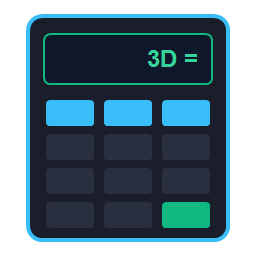

# 🖨️ Калькулятор вартості 3D-друку (3D Print Cost Calculator)

Легковажний, нативний Windows-застосунок у сучасних темних тонах для точного комерційного розрахунку собівартості та ціни 3D-друку для клієнтів.



---

## 🌟 Основні можливості

- **🚀 Нативний та надлегкий (< 90 КБ)**:
  - Створено на базі C# / WPF під .NET Framework 4.8 (вбудований у всі версії Windows 10 та Windows 11).
  - Миттєвий запуск без затримок і без необхідності встановлювати сторонні середовища (Node.js, Python, Electron не потрібні).
  - Має вбудовану іконку калькулятора.

- **🌐 Мультимовність (3 мови)**:
  - 🇺🇦 **Українська (UK)** — мова за замовчуванням
  - 🇬🇧 **English (EN)**
  - 🇧🇬 **Български (BG)**
  - Миттєве перемикання мови інтерфейсу в 1 клік у шапці програми.

- **💶 Валюти розрахунку**:
  - Підтримка євро (**€**) та гривні (**₴**) зі збереженням обраної валюти.

- **🎨 Сучасний темний інтерфейс (Dark Theme)**:
  - Глибокі графітові відтінки (`#0F1117`, `#1E222D`), м'які контрастні межі, яскравий білий шрифт для зручного читання, неонові смарагдові (`#10B981`) та ціанові (`#38BDF8`) акценти.

- **🧵 База та конфігурація філаментів**:
  - Вибір матеріалу зі списку зі швидким переглядом щільності ($г/см^3$) та ціни за 1 кг.
  - Вбудована вкладка **«База філаментів»**: можливість додавати нові типи пластику, редагувати параметри (назва, тип, щільність, вартість за кг) та видаляти застарілі.
  - Автоматичне збереження в конфігураційному файлі `filaments.json`.

- **⚡ Зручні швидкі пресети**:
  - **Витрата філаменту (г)**: поле вводу та швидкі кнопки (25г, 50г, 100г, 200г, 350г, 500г).
  - **Час друку**: роздільний ввід годин та хвилин + кнопки пресетів (1г, 2г, 4г, 6г, 10г, 24г).
  - **Тариф години принтера**: врахування електроенергії, амортизації та сервісу.
  - **Відсоток націнки**: швидкий вибір маржі (0%, 25%, 40%, 50%, 75%, 100%, 150%).

- **📋 Кошторис в 1 клік**:
  - Кнопка **«Скопіювати кошторис»** формує детальний комерційний розрахунок вибраною мовою та копіює його в буфер обміну для надсилання замовнику.

---

## 📐 Формула розрахунку

$$\text{Вартість філаменту} = \left(\frac{\text{Вага (г)}}{1000}\right) \times \text{Ціна за кг}$$

$$\text{Вартість часу друку} = \left(\text{Години} + \frac{\text{Хвилини}}{60}\right) \times \text{Тариф за годину}$$

$$\text{Собівартість виробу} = \text{Вартість філаменту} + \text{Вартість часу друку}$$

$$\text{Сума націнки (прибуток)} = \text{Собівартість} \times \left(\frac{\text{Націнка \%}}{100}\right)$$

$$\text{Загальна вартість (без ПДВ)} = \text{Собівартість} + \text{Сума націнки}$$

$$\text{ПДВ 20\%} = \text{Загальна вартість (без ПДВ)} \times 0.20$$

$$\mathbf{\text{РАЗОМ ДО СПЛАТИ З ПДВ (20\%)}} = \text{Загальна вартість (без ПДВ)} \times 1.20$$

---

## 📂 Структура проєкту

- `3DPrintCalculator.exe` — готовий виконуваний файл програми з іконкою калькулятора.
- `app.ico` / `app.png` — іконка застосунку у вигляді калькулятора.
- `App.cs` — точка входу та глобальні темні XAML-стилі контролів.
- `MainWindow.cs` — логіка головного вікна, інтерфейс, живі підрахунки та керування філаментами.
- `Localization.cs` — словник перекладів (Українська, English, Български).
- `Models.cs` — моделі даних (`Filament`, `AppSettings`, `CalculationResult`).
- `DataService.cs` — збереження бази філаментів та налаштувань у форматі JSON.
- `build.bat` / `build.ps1` — скрипти миттєвої компіляції за допомогою стандартного `csc.exe`.

---

## 🛠️ Як зібрати проєкт

Для компіляції використовується штатний компілятор C#, вбудований у Windows:
```powershell
.\build.ps1
```
або подвійним кліком по `build.bat`.
